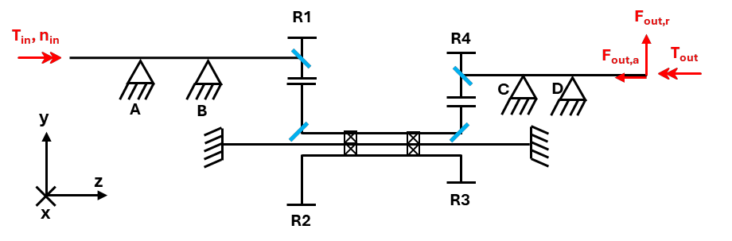
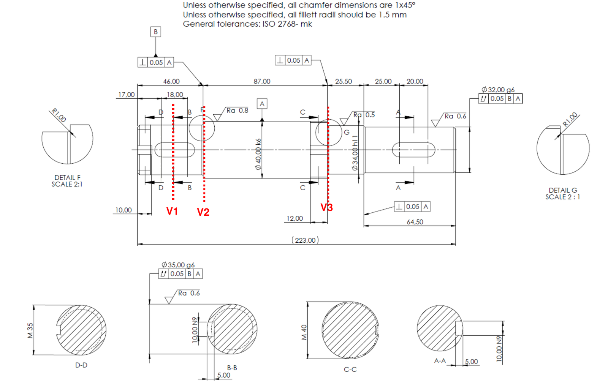
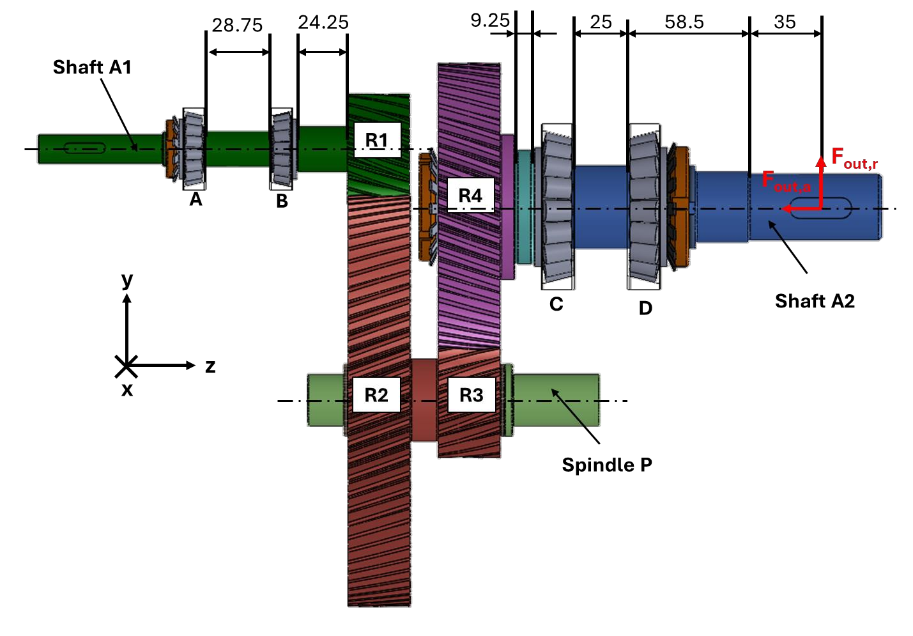
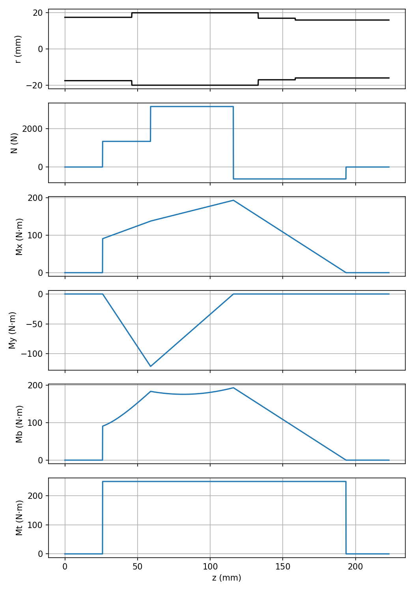
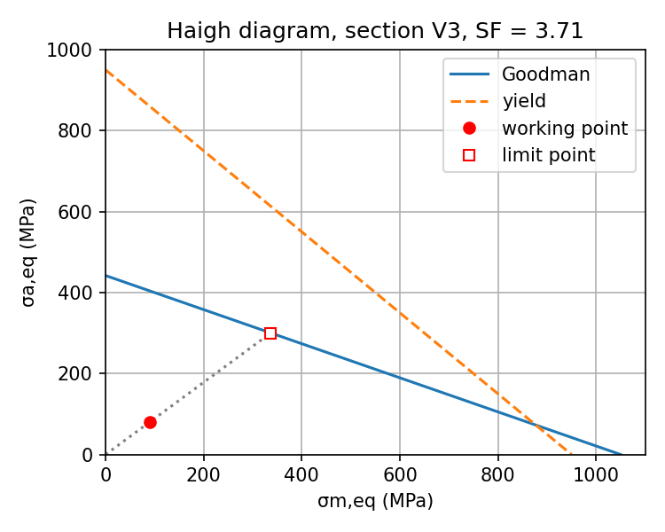

# Gearbox verification: shaft, helical gears and tapered roller bearings

Course project for **Fundamentals of Machine Design** (Politecnico di Torino, A.Y. 2024/25).
It verifies a two-stage helical reduction gearbox (6 kW at 2500 rpm in, about 230 rpm out):

- **Output shaft A2:** internal loads, then a static check (von Mises) and a fatigue check (Shigley/Goodman) at three critical sections.
- **Pinions R1 and R3:** AGMA bending and pitting.
- **Tapered roller bearings A–D:** SKF rating life and static safety.

**Why I revised it:** I went back to this project after the course to turn it into a clear, reproducible portfolio piece, i decided to use Python (other option was Matlab, however i took this as an opportunity to further practice Python) . While redoing the calculations in a Jupyter notebook several errors were revealed in our original group report (January 2025), which this edition corrects; see [below](#what-changed-from-the-original-submission).

📓 **[Open the notebook](gearbox_verification.ipynb)**: 
📄 **[Read the report (PDF)](report/main.pdf)**:

## The gearbox

<p align="center">
  
</p>
<p align="center"><em>Gearbox assembly drawing: input shaft A1 with pinion R1, gears R2 and R3 on spindle P, gear R4 keyed on the output shaft A2. Bearings A, B (SKF 30203) support A1 and C, D (SKF 30208) support A2.</em></p>

<p align="center">
  
</p>
<p align="center"><em>Functional scheme: input torque and speed on A1, end-user forces F<sub>out,r</sub> and F<sub>out,a</sub> on A2, and the global x-y-z frame used in all calculations.</em></p>

<p align="center">
  
</p>
<p align="center"><em>Layout with the dimensions used to place the bearings, gears and the end-user load along the shafts.</em></p>

**Shaft A2**, the main object of the verification, with the three sections V1–V3 checked for fatigue:

<p align="center">
  
</p>

V1 is at the keyseat for gear R4, and V2 and V3 are the shoulders next to the bearing seats, both with a 1 mm fillet (details F and G).

<sub>Figures: from the course project brief (02SXJJM Fundamentals of Machine Design, Politecnico di Torino, A.Y. 2024/25), reproduced for reference.</sub>

## Data

**Gears:** normal module 2.5 mm, helix angle 20°, normal pressure angle 20°, face width 30 mm, accuracy level Q<sub>v</sub> = 7.

| Gear | Teeth | Helix hand | Material limits σ<sub>FP</sub> / σ<sub>HP</sub> (MPa) | Hardness |
|---|---|---|---|---|
| R1 (pinion) | 18 | right | 320 / 860 | 335 HB |
| R2 | 73 | left | 450 / 1360 | 560 HB |
| R3 (pinion) | 19 | left | 450 / 1360 | 560 HB |
| R4 | 51 | right | 320 / 860 | 335 HB |

**Shaft A2:** 34NiCrMo6, σ<sub>u</sub> = 1050 MPa, σ<sub>y</sub> = 950 MPa, rotating-bending fatigue limit σ<sub>D−1</sub> = 520 MPa.

**Bearings** (SKF Explorer tapered roller bearings, back-to-back; data from the SKF rolling bearings catalogue):

| Bearing | Shaft | d × D × T (mm) | C (kN) | C<sub>0</sub> (kN) | P<sub>u</sub> (kN) | e | Y | Y<sub>0</sub> |
|---|---|---|---|---|---|---|---|---|
| 30203 (A, B) | A1 | 17 × 40 × 13.25 | 23.4 | 18.6 | 1.83 | 0.35 | 1.7 | 0.9 |
| 30208 (C, D) | A2 | 40 × 80 × 19.75 | 75.8 | 68.0 | 7.65 | 0.37 | 1.6 | 0.9 |

## Method and equations

**Gear forces.** The transverse pressure angle is $\tan\varphi_t = \tan\varphi_n / \cos\psi$, and at each mesh

$$F_t = \frac{T}{r}, \qquad F_r = F_t \tan\varphi_t, \qquad F_a = F_t \tan\psi$$

The directions come from 3-D vectors built from the helix hand and the direction of rotation. The axial force acts at the pitch radius, so it also adds a moment $F_a\,r$ on the shaft.

**Static check** (static diameter: keyseat depth removed, smaller diameter at shoulders):

$$\sigma_{id} = \sqrt{\left(|\sigma_N| + \sigma_{M_B}\right)^2 + 3\tau^2}, \qquad SF = \frac{\sigma_y}{\sigma_{id}}$$

**Fatigue check** (Shigley). Bending is fully reversed; axial load and torque are constant. With $K_f = 1 + q\,(K_t - 1)$ and $\sigma_{D-1}^c = C_S\,C_F\,\sigma_{D-1}$:

$$\sigma_{a,eq} = \sqrt{\left(K_{f,B}\,\sigma_a^B + K_{f,N}\,\frac{\sigma_a^N}{0.85}\right)^2 + 3\left(K_{f,T}\,\tau_a\right)^2}, \qquad \sigma_{m,eq} = \sqrt{\left(K_{f,B}\,\sigma_m^B + K_{f,N}\,\sigma_m^N\right)^2 + 3\left(K_{f,T}\,\tau_m\right)^2}$$

$$\frac{1}{SF_f} = \frac{\sigma_{a,eq}}{\sigma_{D-1}^c} + \frac{\sigma_{m,eq}}{\sigma_u} \qquad \text{(Goodman, proportional loading)}$$

**Gears** (AGMA):

$$\sigma_b = \frac{F_t\,K_O\,K_v\,K_s\,K_H\,K_B}{b\,m_t\,Y_J}, \qquad S_F = \frac{\sigma_{FP}\,Y_N}{Y_\theta\,Y_Z\,\sigma_b}$$

$$\sigma_H = Z_E\sqrt{\frac{F_t\,K_O\,K_v\,K_s\,K_H\,Z_R}{b\,d_P\,Z_I}}, \qquad S_H = \frac{\sigma_{HP}\,Z_N\,Z_W}{Y_\theta\,Y_Z\,\sigma_H}$$

**Bearings** (SKF). Axial loads follow the SKF rules for a back-to-back pair. Then

$$P = \begin{cases} F_r & F_a/F_r \le e \\ 0.4\,F_r + Y F_a & F_a/F_r > e \end{cases}, \qquad L_{5m,h} = \frac{10^6}{60\,n}\; a_1\, a_{SKF} \left(\frac{C}{P}\right)^{10/3}$$

with $a_1 = 0.64$ for 95 % reliability and $a_{SKF}$ from the viscosity ratio κ and the contamination factor η<sub>c</sub>.

## Results

| Component | Check | Result |
|---|---|---|
| Shaft A2 | Static, required sections | SF<sub>min</sub> = 10.65 (V1, keyseat) |
| Shaft A2 | Static, whole shaft | SF<sub>min</sub> = 8.43 (keyseat L3) |
| Shaft A2 | Fatigue (Goodman) | V1 5.67 · V2 4.36 · **V3 3.71** |
| Pinion R1 | AGMA bending / pitting | S<sub>F</sub> = 7.62 / S<sub>H</sub> = 1.84 |
| Pinion R3 | AGMA bending / pitting | S<sub>F</sub> = 3.20 / **S<sub>H</sub> = 1.57** |
| Bearings A, B (30203) | SKF L<sub>5m,h</sub> | 52 614 h / 49 948 h |
| Bearings C, D (30208) | SKF L<sub>5m,h</sub> | 205 893 h / 63 792 h |

Every component passes. The governing margins are fatigue at shoulder V3 of shaft A2 and pitting of pinion R3.

<p align="center">
  
  
</p>

## Challenges

- **Finding errors in a submitted report.** The original results looked plausible, but several were wrong by large factors. The biggest error, `tan(20)` evaluated in radians, made the axial gear forces about six times too large and inflated everything downstream. Checking units and orders of magnitude at every step became a habit.
- **Directions of the helical gear forces.** Each force direction depends on the helix hand, on whether the gear drives or is driven, and on the direction of rotation. Getting one sign wrong moves a bearing reaction or flips a moment. I built the forces as vectors from the geometry and checked them with action = reaction at both meshes.
- **The axial-force couple.** The axial force acts at the pitch radius, so it also bends the shaft, but only in the plane that contains the contact point (y–z). Applying it in both planes had made the maximum bending moment four times too large.
- **Reading geometry from the drawings.** The bearing reactions act at the SKF pressure centres, not at the middle of the bearings. For a back-to-back pair they sit outboard, at distance *a* from the inner face. Every position along the shafts had to be built up from drawing dimensions and catalogue values.
- **Values read from charts.** Stress concentration factors, AGMA factors and SKF life factors come from diagrams, and one K<sub>t</sub> curve does not even reach r/d = 0.029, so it had to be extrapolated. I collected every chart reading in one place, with its source, so each judgement call is visible.
- **Mixed units in the standards.** The AGMA formulas use inches and ft/min, while the rest of the calculation is in mm, N and m/s. I kept the conversions explicit inside the formulas where they are needed.
- **Checking without a reference solution.** There was no answer to compare against, so I wrote independent checks: power conservation, pitch-line speeds, hand moment equations about each support, and stresses worked out by hand at known points. The checks caught real mistakes, including a wrong diameter at section V2.


## How the notebook is organised

1. Input data (brief, SKF catalogue, chart readings)
2. Gear geometry and kinematics
3. Mesh forces
4. Support reactions and axial bearing loads
5. Internal loads along shaft A2
6. Static check
7. Fatigue check with Haigh diagrams
8. AGMA check of R1 and R3
9. SKF bearing life
10. Consistency checks: hand calculations and physical laws (power conservation, equilibrium, action = reaction) that must agree with the results

## Run it

```bash
pip install -r requirements.txt
```

Then open `gearbox_verification.ipynb` in Jupyter or VS Code and choose **Run All**. The plots are saved to `figures/`.

The report source is `report/main.tex`; it uses the plots in `figures/`. Compile it from the `report` folder with `latexmk -pdf main.tex`.

## What changed from the original submission

| Topic | Original | Revised |
|---|---|---|
| Axial gear forces | `tan(20)` evaluated in radians → 2142 / 8229 N | 348.4 / 1338.5 N |
| End-user force | from the intermediate torque (92.96 N·m) → 930 N | from T<sub>A2</sub> = 249.49 N·m → 2494.9 N |
| Axial-force couple | applied in both planes → M<sub>B,max</sub> = 775 N·m | y–z plane only → 193.35 N·m |
| Fatigue | V3 only | V1, V2 and V3, with Haigh diagrams |
| AGMA | 1/(b·m<sub>t</sub>·Y<sub>J</sub>) applied as a product; wrong mesh force for R1; R3 at the input speed; Z<sub>I</sub> ≈ 0.85 | corrected |
| Bearing life | missing 10/3 exponent; no 10⁶/(60n) conversion → 22–1065 h | 49 948 – 205 893 h |

## Credits

The revised notebook was prepared  by Fatima Zouhour.

Group 27: Fatima Zouhour, Rawan El Halabi, Fatima Srour. The original January 2025 report was group work.

AI assistance was used to help identify errors and bugs in the python code.

The figures in `figures/brief/` come from the course project brief. The brief itself, the course templates and the SKF catalogue belong to their owners and are not included here.